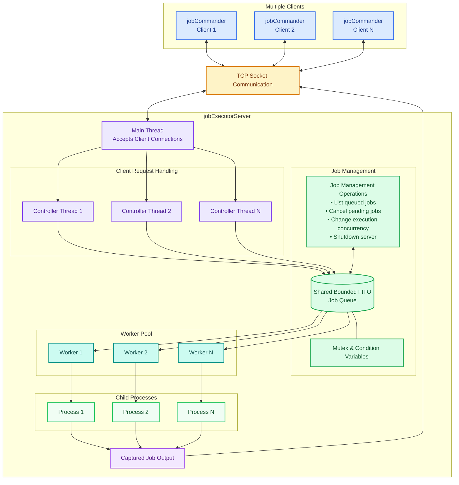

# System-Programming-Project

# Multithreaded Network Job Execution Server

A client-server job execution system implemented in **C** using **POSIX threads, TCP/IP sockets, and Unix process-management APIs**.

The project allows clients to submit shell-style commands and run executables and programs to a remote server, where jobs are stored in a bounded shared queue and executed by a configurable pool of worker threads. It demonstrates practical operating-systems concepts including concurrency, producer-consumer synchronization, process creation, inter-process output handling, and network communication.

> **Academic project:** Operating Systems / Systems Programming  
> **Grade:** 97/100

---

## Table of Contents

- [Overview](#overview)
- [Architecture](#architecture)
- [How It Works](#how-it-works)
- [Supported Commands](#supported-commands)
- [Build](#build)
- [Run](#run)
- [Example Workflow](#example-workflow)
- [Concurrency and Synchronization](#concurrency-and-synchronization)
- [Process Management and Output](#process-management-and-output)
- [Project Structure](#project-structure)
- [Technologies and Concepts](#technologies-and-concepts)
- [Testing](#testing)
- [Limitations and Future Improvements](#limitations-and-future-improvements)
- [Academic Context](#academic-context)

---

## Overview

The system consists of two executables:

- **`jobExecutorServer`** — accepts client connections, manages the shared job queue, and coordinates job execution.
- **`jobCommander`** — a command-line client that connects to the server and submits job-management requests.

When a client submits a job, the server places it in a bounded FIFO queue. A pool of worker threads retrieves queued jobs and launches them as separate processes. The number of jobs allowed to execute concurrently can be adjusted at runtime.

The client can also inspect queued jobs, cancel jobs that have not yet started, change the execution concurrency, and request server shutdown.

## Architecture





### Main components

| Component | Responsibility |
|---|---|
| Main server thread | Initializes shared resources, creates worker threads, accepts client connections, and coordinates server shutdown. |
| Controller threads | Handle client requests and perform the corresponding job-management operations. |
| Shared job queue | Stores pending jobs in FIFO order with a configurable capacity. |
| Worker threads | Wait for available work, retrieve jobs, and manage their execution. |
| Child processes | Execute submitted commands independently of the server's worker-thread code. |
| Client | Sends commands to the server and displays job information and execution output. |

## How It Works

### 1. Client-server communication

The client connects to the server through a TCP socket and sends a request containing a command and its associated arguments.

The server accepts the connection and dispatches the request for handling. Depending on the command, the server may enqueue a job, return queue information, cancel a pending job, update the concurrency limit, or initiate shutdown.

### 2. Job submission and queueing

When the client issues a job-submission request:

1. The server receives the command.
2. A job entry is created and assigned a job identifier.
3. The job is inserted into the shared bounded FIFO queue.
4. Waiting worker threads are notified that work may be available.
5. A worker retrieves the job when execution capacity is available.

The bounded queue limits the number of pending jobs and provides backpressure when it becomes full.

### 3. Worker pool and execution concurrency

The server creates a worker-thread pool at startup. Worker threads repeatedly wait for work, retrieve jobs from the queue, and execute them.

A separate concurrency limit controls how many jobs may execute simultaneously. This limit can be changed while the server is running.

### 4. Job management

Clients can inspect pending jobs, cancel a job that is still queued, and change the maximum number of concurrently executing jobs.

The server also handles shutdown by stopping further request processing, coordinating worker termination, and notifying clients about jobs that remain queued and therefore cannot be executed.

---

## Supported Commands

The client supports the following job-management operations.

| Command | Description |
|---|---|
| `issueJob <command> [arguments...]` | Submits a command for execution by the server. |
| `poll` | Displays jobs currently waiting in the shared queue. |
| `stop <jobID>` | Requests cancellation of a job that is still waiting in the queue. |
| `setConcurrency <N>` | Changes the maximum number of jobs allowed to execute concurrently. |
| `exit` | Requests server shutdown. |

A job identifier is generated by the server and follows the form `job_N`, where `N` is a numeric identifier.

**Note:** `poll` reports pending jobs in the queue; it should not be interpreted as a complete history of running or completed jobs.

## Build

### Requirements

- Linux or another POSIX-compatible environment
- GCC
- GNU Make
- POSIX threads (`pthread`)
- Standard C library and Unix process APIs

### Compile

From the project root, run:

```bash
make
```

or:

```bash
make all
```

The Makefile compiles the source files and creates the two executables in the `bin/` directory:

```text
bin/jobExecutorServer
bin/jobCommander
```

To remove generated object files and executables:

```bash
make clean
```

## Run

### 1. Start the server

```bash
./bin/jobExecutorServer <port> <buffer_size> <thread_pool_size>
```

Arguments:

| Argument | Description |
|---|---|
| `port` | TCP port on which the server listens. |
| `buffer_size` | Maximum number of pending jobs in the shared queue. |
| `thread_pool_size` | Number of worker threads created by the server. |

Example:

```bash
./bin/jobExecutorServer 8080 128 4
```

This starts the server on port `8080`, with a queue capacity of `128` pending jobs and a pool of `4` worker threads.

### 2. Send requests using the client

The client follows this general syntax:

```bash
./bin/jobCommander <server_host> <port> <command> [arguments...]
```

Examples:

Submit a job:

```bash
./bin/jobCommander localhost 8080 issueJob sleep 3
```

Submit another job:

```bash
./bin/jobCommander localhost 8080 issueJob ls -l
```

Inspect pending jobs:

```bash
./bin/jobCommander localhost 8080 poll
```

Change the execution concurrency:

```bash
./bin/jobCommander localhost 8080 setConcurrency 2
```

Cancel a queued job:

```bash
./bin/jobCommander localhost 8080 stop job_0
```

Request server shutdown:

```bash
./bin/jobCommander localhost 8080 exit
```

Run the server in one terminal and issue client commands from another terminal.

---

## Example Workflow

The following illustrates a typical usage scenario.

**Terminal 1 — Start the server**

```bash
./bin/jobExecutorServer 8080 128 4
```

**Terminal 2 — Submit jobs**

```bash
./bin/jobCommander localhost 8080 issueJob sleep 5
./bin/jobCommander localhost 8080 issueJob ls -l
./bin/jobCommander localhost 8080 issueJob date
```

**Inspect pending jobs**

```bash
./bin/jobCommander localhost 8080 poll
```

**Change the execution limit**

```bash
./bin/jobCommander localhost 8080 setConcurrency 2
```

**Cancel a job that has not started**

```bash
./bin/jobCommander localhost 8080 stop job_2
```

**Shut down the server**

```bash
./bin/jobCommander localhost 8080 exit
```

The exact job identifiers and which jobs remain pending depend on scheduling and execution timing.

---

## Concurrency and Synchronization

A central part of the project is the implementation of a **multiple-producer, multiple-consumer** queue.

Controller threads act as producers by submitting jobs, while worker threads act as consumers by retrieving jobs for execution.

### Mutex

A mutex protects shared queue state and related counters. It ensures that concurrent threads do not modify the queue simultaneously or observe inconsistent queue state.

### Condition variables

Two condition variables coordinate access to the bounded queue:

- **`nonempty`** — workers wait when there are no jobs available or when the execution concurrency limit has been reached.
- **`nonfull`** — producers wait when the queue has reached its capacity.

Condition-variable waits allow threads to sleep until a relevant state change occurs, avoiding continuous busy-waiting.

### Runtime concurrency adjustment

When the concurrency limit is increased, waiting workers are notified so that additional queued jobs can become eligible for execution.

This separates the size of the worker pool from the maximum number of jobs that may execute at the same time.

---

## Process Management and Output

Worker threads coordinate job scheduling, while submitted commands are executed in child processes.

The implementation uses Unix process and file-descriptor APIs, including:

- `fork()` to create a child process for command execution.
- `execvp()` to execute the requested program.
- `waitpid()` to wait for child-process completion.
- `dup2()` to redirect standard output.
- File operations to store and retrieve command output.

The server returns execution output to the client over the TCP connection.

Using separate processes for submitted commands keeps command execution separate from the worker thread's scheduling responsibilities.

---

## Project Structure

```text
.
├── Makefile
├── README.md
├── include/
│   ├── buffer.h
│   ├── commands.h
│   ├── Info.h
│   ├── jobinfo.h
│   ├── threads.h
│   └── utility.h
├── src/
│   ├── buffer.c
│   ├── commands.c
│   ├── jobCommander.c
│   ├── jobExecutorServer.c
│   ├── threads.c
│   └── utility.c
├── tests/
│   └── progDelay.c
└── bin/                 # Generated executables and object files
```

### Source-file responsibilities

- `buffer.c` — shared bounded queue operations.
- `commands.c` — server-side command handling and job-management operations.
- `jobCommander.c` — client-side argument parsing, socket communication, and response handling.
- `jobExecutorServer.c` — server initialization and entry point.
- `threads.c` — main server loop, controller threads, worker threads, and synchronization.
- `utility.c` — common helper functions, command parsing, process execution, and output handling.

---

## Technologies and Concepts

| Technology / Concept | Application |
|---|---|
| C | Core implementation language. |
| POSIX Threads (`pthreads`) | Worker and controller thread management. |
| TCP/IP sockets | Communication between client and server. |
| Mutexes | Protection of shared queue state. |
| Condition variables | Producer-consumer coordination without busy-waiting. |
| Bounded FIFO queue | Storage and scheduling of pending jobs. |
| `fork()` / `execvp()` | Creation and execution of child processes. |
| `waitpid()` | Child-process lifecycle management. |
| `dup2()` | Standard-output redirection. |
| Makefile | Compilation and build automation. |

## Testing

The project was manually tested with different job submissions and job-management operations.

The repository also includes `tests/progDelay.c`, a small helper program that can be used in experiments involving delayed execution and worker scheduling.

Useful scenarios to test include:

- Submitting multiple jobs.
- Submitting more jobs than the configured queue capacity.
- Running jobs with different execution durations.
- Changing the concurrency limit while jobs are pending.
- Polling an empty and a non-empty queue.
- Cancelling a job before it begins execution.
- Shutting down while jobs are queued or executing.

These scenarios are useful for examining queue behavior, synchronization, scheduling, and process lifecycle handling.

## Limitations and Future Improvements

Possible areas for further development include:

- More robust TCP message framing and handling of partial socket reads and writes.
- Stronger input validation and error handling.
- Additional memory-management and resource-cleanup checks.
- More extensive automated tests for concurrency and network edge cases.
- Improved tracking of running and completed jobs.
- More structured logging and execution-status reporting.

These are potential extensions and hardening tasks, rather than claims that all of them are already implemented.

